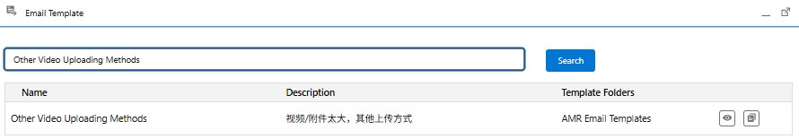

# Video Too Large for Email Attachment — Cloud-Drive Link Script

> Source: 流程相关 · Alexia · 2026-10-16

若用户反馈**视频过大**、**无法作为邮件附件**发送，可参考以下话术，引导用户通过**云盘链接**分享视频/图片。/ If the customer reports a **video too large** to attach to an email, use the script below to guide them to share the video/images via a **cloud-drive link**.

> If the video file is too large to attach to an email, you may upload it to Google Drive, iCloud, or Dropbox and share the link with us. This will allow our team to review the video and provide you with more accurate assistance.

