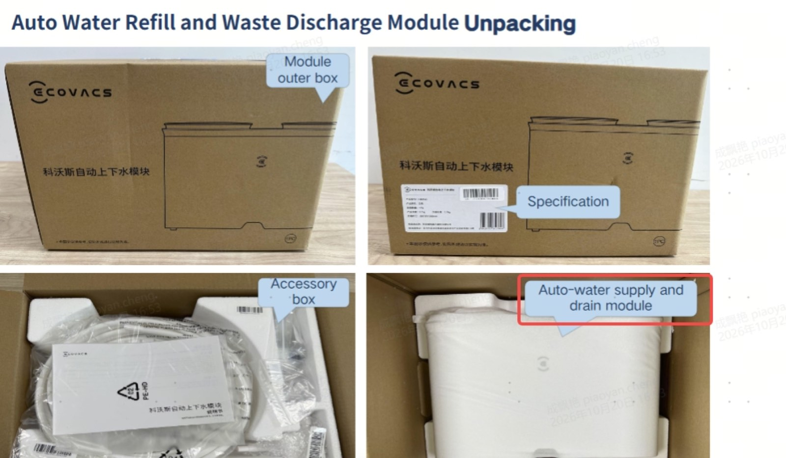
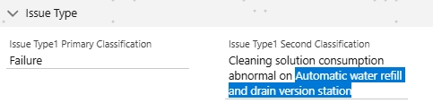
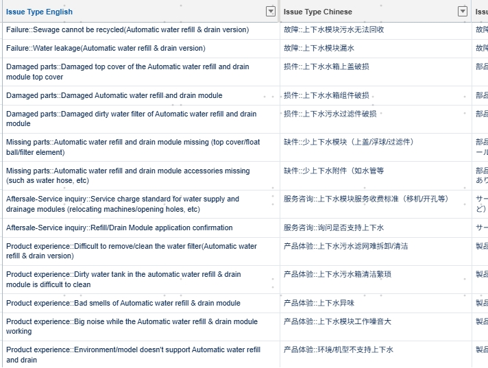

# QA Standard Sync — Refill/Drain Module Issue Types Not Applicable in NA

> Source: 流程相关 · Hoi · 2026-10-21

质检标准同步（2026-10-20）：目前北美机器**不支持上下水模组**。/ QA standard sync (2026-10-20): North American machines **do not support the automatic water refill/drain module**.

如果 issue type 里带有 **Automatic water refill and drain module**、**Refill/Drain Module**、**water recycle module** 这类，都是针对上下水模组的专用问题——故障、使用问题、使用体验类，一般情况下北美都不适用。不管前半部分描述跟问题多贴切，都请"**避雷**"。/ Issue types containing **Automatic water refill and drain module**, **Refill/Drain Module**, **water recycle module**, etc., are dedicated to the refill/drain module — faults, usage issues, and experience complaints generally do not apply in NA. No matter how well the first half of the description matches, **avoid these**.

**补充 / Exception：** 客户问"能不能用"的咨询类情景，情景合适可以选 **Aftersale-Service inquiry: Refill/Drain Module application confirmation**。/ For "can I use it" inquiries where the context fits, select Aftersale-Service inquiry: Refill/Drain Module application confirmation.

