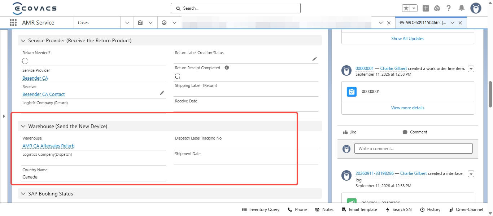

# WO Missing Tracking Number — Interim Lookup Sheet

> Source: 流程相关 · Hoi · 2026-10-26

**【临时干预方案 2026-10-26 ET】WO 中不显示物流**

如果用户进线咨询**质保流程替换机的物流单号**，但发现 WO 中**没有 Tracking 回传同步**，可先查询此表单：[WO Tracking Interim Lookup Sheet](https://ecovacs.feishu.cn/sheets/Tvy2sB0ZYhnhL7t8Xy2cv7OZn3d?sheet=0ScCdf)（内部访问）。

示例 / Example: `WE16515` / `WO260911504665`

——

**【Interim workaround 2026-10-26 ET】Tracking numbers not showing in WO**

When a customer asks for the **tracking number of a replacement unit** from the warranty flow but the WO shows **no synced Tracking information**, look the number up in this sheet first: [WO Tracking Interim Lookup Sheet](https://ecovacs.feishu.cn/sheets/Tvy2sB0ZYhnhL7t8Xy2cv7OZn3d?sheet=0ScCdf) (internal access).

Example / 示例: `WE16515` / `WO260911504665`
