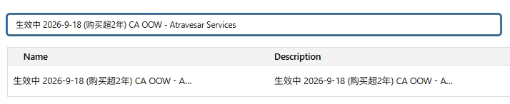
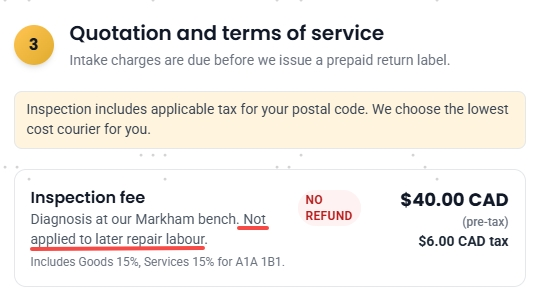

# Canada Out-of-Warranty — Atravesar Services Inspection Fee Update

> Source: 流程相关 · Hoi · 2026-10-27

**【Atravesar Services】加拿大保外服务细则更新**

- **40 CAD 检查费不会**并入总维修费用。该细则已更新至 [CA OOW Wiki](https://lmgx8md8u1.feishu.cn/wiki/VeKqwnu57iEJimkLYX2caEqoneh?renamingWikiNode=false#share-NlCtdSxeXow4gHxygJmcm7Sfnbf)，Salesforce 中的邮件模版也已同步更新。
- **生效中 2026-9-18（购买超 2 年）CA OOW - Atravesar Services**，流程与话术见下方模版。

**邮件模版 / Email template：**

> Thank you for contacting ECOVACS. We've taken a close look at your purchase record, and we're sorry to let you know that your machine is now past the one-year warranty period, so it's no longer covered under our standard warranty service.
>
> That said, we do want to help you get it fixed. For machines out of warranty in Canada, we work with **Atravesar Services**, a trusted ECOVACS partner service center, who can professionally diagnose and provide service for you.
>
> **Getting started is simple — just 3 steps:**
> 1. **Fill in the form with your details** on the [Atravesar Services Repair Request form](https://www.atravesar.ca/OOW-Webform/)
> 2. **Receive your quotation** and payment link (The inspection fee is CAD 40, payable upfront)
> 3. **Pay and ship** your unit to the repair center
>
> **Atravesar Services:**
> Address: Dock 5, 145 Riviera Dr, Markham, ON L3R 5J6, Canada
> Phone (9:00 AM – 5:00 PM on workdays): +1 (647) 636-5234 / +1 (905) 887-4222
> Email: info@atravesar.ca

——

**【Atravesar Services】Canada out-of-warranty service details update**

- The **CAD 40 inspection fee is NOT** merged into the total repair cost. The details have been updated in the [CA OOW Wiki](https://lmgx8md8u1.feishu.cn/wiki/VeKqwnu57iEJimkLYX2caEqoneh?renamingWikiNode=false#share-NlCtdSxeXow4gHxygJmcm7Sfnbf), and the email template in Salesforce has been updated accordingly.
- **In effect since 2026-9-18 (purchase older than 2 years) CA OOW - Atravesar Services** — see the template below for the flow and script.

**Flow recap / 流程回顾：**
1. Customer fills in the [Atravesar Services Repair Request form](https://www.atravesar.ca/OOW-Webform/)
2. Quotation + payment link issued (**inspection fee CAD 40, payable upfront**)
3. Customer pays and ships the unit to the repair center (Dock 5, 145 Riviera Dr, Markham, ON L3R 5J6 · +1 (647) 636-5234 / +1 (905) 887-4222 · info@atravesar.ca)
