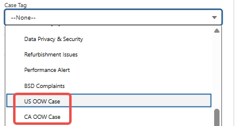
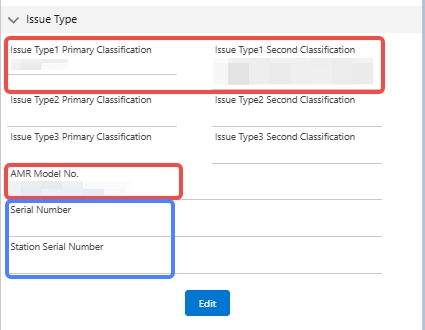

# QC Pitfalls — Two-Week Deduction Review

> Source: 流程相关 · Alexia · 2026-10-27

近两周质检重点扣分项避雷清单：

- 💣 **避雷 1：通话称谓** — 电话中未称呼客人两次及以上，只要不够两次，**直接扣 10 分**。
- 💣 **避雷 2：Call Note 完整性** — 电话中缺少用户信息（电话号码、名字、型号），或 Call Note 中记录的**型号信息不精准**，都算不完整。
- 💣 **避雷 3：Case Tag（每错一项扣 15 分）** — 针对**美国/加拿大过保用户**，务必选择**对应国家**的 **OOW Case**。
- 💣 **避雷 4：Issue Type、Model 与 SN 信息** — Issue Type 选错、Model 选错（历史记录有但选 unknown）；用户提供了地宝/基站 SN 但未及时填写到左侧信息栏。
- 💣 **关差避雷：重复收集** — 一个重复索要就是 B 类关差。
- 💣 **关差避雷：Dead Air** — 客人说话后我们超过 5 秒没有在电话中回应，就是一个 C 类关差。

——

**QC pitfalls from the past two weeks — avoid these deductions:**

- **Greeting**: failing to address the customer by name at least **twice** on a call is an instant **-10**.
- **Call Note completeness**: missing user info (phone number, name, model) or an **imprecise model** recorded in the note counts as incomplete.
- **Case Tag (15 points each)**: for US/CA out-of-warranty customers, always pick the **country-specific OOW** case tag.
- **Issue Type / Model / SN**: wrong issue type, wrong model (history exists but "unknown" selected), or a provided robot/dock SN not entered into the info panel.
- **Escalation pitfall — repeated collection**: asking for the same info twice is a Class-B escalation.
- **Escalation pitfall — dead air**: more than 5 seconds of silence after the customer speaks is a Class-C escalation.
