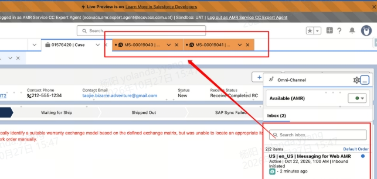

# Salesforce New Features — Chat, AMR Shipping Limits, WO Changes

> Source: General · Hoi · 2026-10-27

Salesforce 即将上线的功能（2026-10-27 重点快览）：

**Chat 功能优化：**
1. 客户发送信息时将 **highlight** 展示
2. 所有坐席皆忙碌时，客户发起聊天会收到"坐席正忙、排队中"提示
3. 坐席释放后**自动接入**排队中的客户
4. 同一客户当天再次进线，可在聊天页面右侧往下滚动找到 **"Chat History" Tab**
5. 点击 Chat History 可查看该客户**近 2 天内**的过往聊天记录
6. 点击 **"Open Case"** 可进入聊天记录关联的 Case 详情页

**国家发货限制 — AMR：**
- US 客户 Case 创建 Spare Parts Shipment WO 时，**Add Product 只能搜到 US 库存**
- CA 客户 Case 所需配件无 CA 库存时，可搜索到 **US 仓库库存**（当前 SAP B1 测试环境只有 US 库存数据，上线后以实际为准）

**保外维修工单同步到 SF：**
- SF 已自动拉取维修商保外工单，Work Order Owner 设为 **AMR Service Head**，各 CC 可通过 **「AMR Repair」视图**查看 AMR-Repair WO 数据

**WO Cancel 功能优化：**
- WO Close 时弹出取消原因 **"Cancellation Remarks"** 填写页面

——

**Salesforce features rolling out (2026-10-27 highlights):**

**Chat optimizations:** customer messages render highlighted; when all agents are busy, customers get a queue notice and are auto-connected once an agent frees up; a **Chat History** tab (scroll down on the right panel) shows the customer's chats from the last 2 days, with **Open Case** linking to the related case.

**Country shipping limits — AMR:** US cases creating Spare Parts Shipment WOs can only search US stock in Add Product; CA cases can fall back to US warehouse stock when parts are out of stock in CA (SAP B1 test env is US-only for now).

**OOW repair WO sync:** SF now pulls repair-partner OOW work orders automatically, with Work Order Owner set to AMR Service Head — view them under the **AMR Repair** view.

**WO Cancel:** closing a WO now prompts a **"Cancellation Remarks"** reason page.
