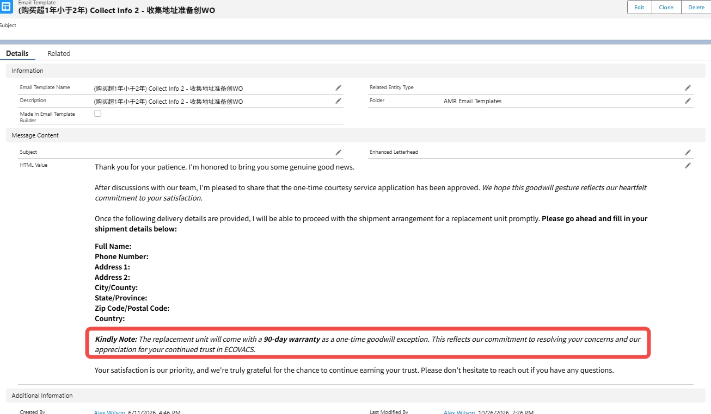
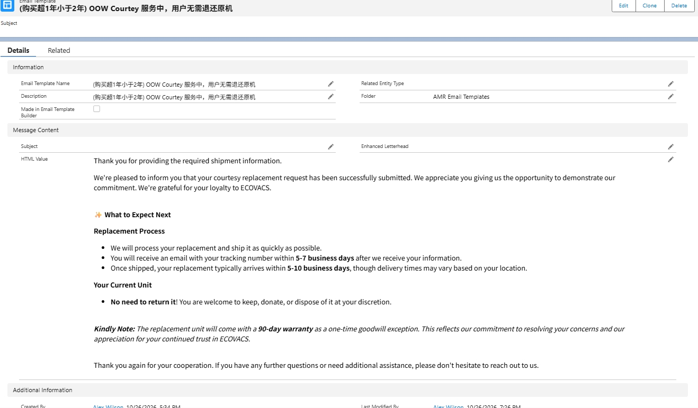
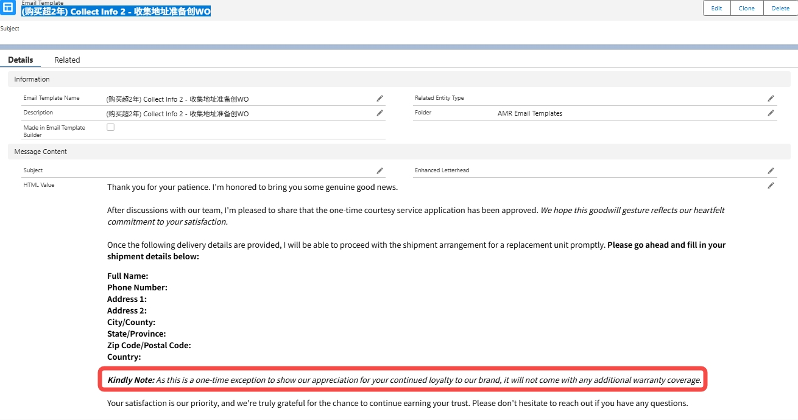
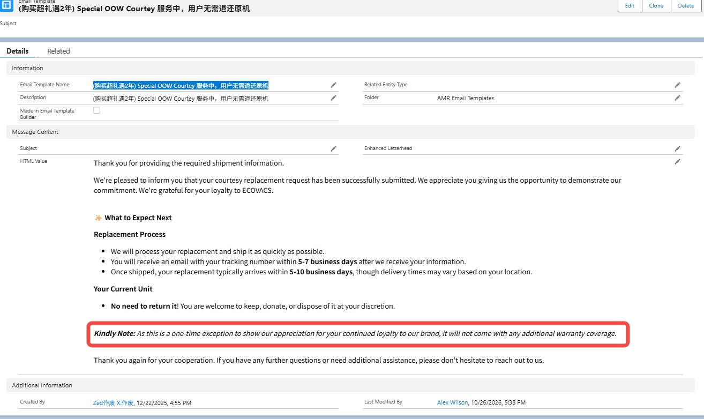

# OOW Courtesy Email Templates — Pick the Right One

> Source: 流程相关 · Alexia · 2026-10-28

处理 **OOW（过保）礼遇换机** 用户时，务必根据**实际情况**选择并发送正确的邮件模板，避免"给超两年用户发 90 天质保"的乌龙。

**🔴 核心区别：**
- **OOW Courtesy（购买 >1 年 且 <2 年）**：换机后享有 **90 天**质保
- **OOW Special Courtesy（购买 >2 年）**：换机后**无**额外质保

**✅ 场景一：购买已超 1 年，但小于 2 年**
- 步骤 1（收集信息）：(购买超1年小于2年) Collect Info 2 — 收集地址准备创 WO
- 步骤 2（确认服务）：(购买超1年小于2年) OOW Courtesy 服务中，用户无需退还原机

**✅ 场景二：购买已超 2 年**
- 步骤 1（收集信息）：(购买超2年) Collect Info 2 — 收集地址准备创 WO
- 步骤 2（确认服务）：(购买超礼遇2年) Special OOW Courtesy 服务中，用户无需退还原机

（更新时间 2026-10-27）

——

When handling **OOW courtesy replacement** customers, choose the correct email template based on their **actual purchase age** — do not send the 90-day-warranty template to 2-year-plus users.

**🔴 Key difference:**
- **OOW Courtesy (purchase >1 yr and <2 yrs)**: the replacement carries a **90-day** warranty.
- **OOW Special Courtesy (purchase >2 yrs)**: **no** extra warranty on the replacement.

Scenario 1 (>1 yr, <2 yrs): use "(购买超1年小于2年) Collect Info 2" to collect the address and create the WO, then "(购买超1年小于2年) OOW Courtesy" to confirm no return of the original unit is needed.

Scenario 2 (>2 yrs): use "(购买超2年) Collect Info 2" and "(购买超礼遇2年) Special OOW Courtesy" respectively — see the four template screenshots above (updated 2026-10-27).
