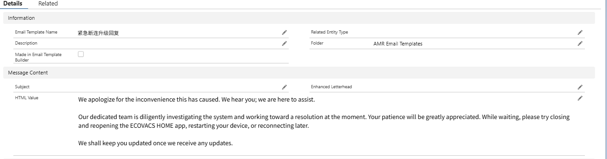

# Connection Outage — Response Flow & Escalation Template

> Source: General · Alexia · 2026-10-29

**【问题收集】突然断连 / Time Out / 无法连接服务器（10-29）**

如遇用户反馈"突然断连、Time Out 或无法连接服务器"：

1. 先按标准流程协助用户完成**基础排障**
2. 排障完成后仍未解决的，收集用户 **SN** 并附上对应 **Case Number** 在群内接龙上报

**断联紧急升级模板**（仅限已收集完信息的用户）：

**若无 SN，也无法 fetch 到，请务必在沟通过程中收集到！**

系统侧确认是服务端问题后（Hoi 同步），无需继续排障，直接告知用户："Some users may experience connection issues with our app right now. Our team is working on it and it will be back soon. Please try again later."

——

**【Issue collection】Sudden disconnection / Time Out / cannot connect to server (Oct 29)**

When users report these symptoms: run the standard basic troubleshooting first; if unresolved, collect the user's **SN** plus the **Case Number** and report it in the group thread.

Use the **urgent escalation template** (screenshot above) **only for users whose info has been fully collected** — and if there is no SN and it cannot be fetched, make sure to obtain it during the conversation.

Once the server-side outage is confirmed, skip further troubleshooting and tell the user: "Some users may experience connection issues with our app right now. Our team is working on it and it will be back soon. Please try again later."
