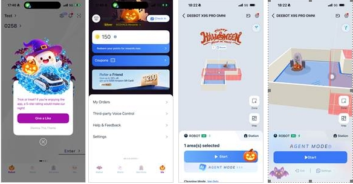
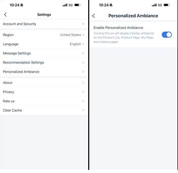

# Halloween App Theme Live — 3D Map Default & How to Turn It Off

> Source: General · Alexia · 2026-10-30

**App 活动上线同步 — 万圣节 App 主题**：App 产品团队在北美（美国和加拿大）区域上线**万圣节专属 App 主题**。

**主题功能推送时间**：2026.10.27 20:00 – 2026.11.02 11:59（GMT+8）

**机型范围：**
- **地宝**：X12、X11、X9S、T90、T80S 及之后全部机型
- **窗宝**：W1 及以后全部机型
- **割草机**：G1 及以后全部机型

活动期间，操控页内涉及氛围功能的地宝型号，用户界面的**地图默认为 3D 视角展示**（与平时默认 2D 不同）。若有用户咨询请帮忙说明，**双击屏幕即可回到 2D 视角**。

**关闭节日元素展示的两种方式：**
- **单次关闭**：主题上线后 App 首页会提示已切换至个性化主题，点击提示弹窗内 **"拒绝这个主题"** 即可关闭此次活动
- **长期关闭**：App 内 **我的 - 设置 - 个性化氛围**，关闭该功能开关后 App 内不再展示节日主题相关功能

——

**Halloween App theme is live for North America (US & CA)**, pushed **Oct 27 20:00 – Nov 2 11:59 (GMT+8)**.

**Eligible models:** DEEBOT X12, X11, X9S, T90, T80S and all later models; WINBOT W1 and later; GOAT (mower) G1 and later.

During the event, the map on the control page defaults to a **3D view** instead of the usual 2D — double-tap the screen to switch back to 2D. Please explain this to users who ask.

**To turn off the holiday theme:**
- **One-time:** tap **"拒绝这个主题" (Reject this theme)** on the homepage popup shown when the theme first applies.
- **Permanently:** in the App go to **Me - Settings - Personalized ambience** and switch it off.
