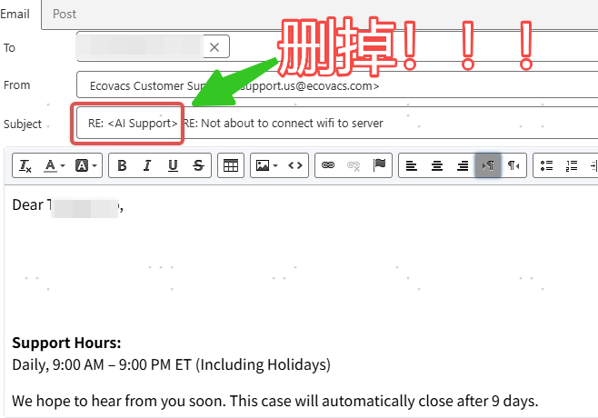

# Remove "AI Support" from Email Subjects Before Replying

> Source: 流程相关 · Hoi · 2026-10-30

AI Agent 回复邮件之后，邮件编辑栏 / Interaction - Email 的**主题/Subject 会自动出现 "AI Support" 字样**。请各位在回复时**手动把这块删掉**，以减少用户误解，感谢配合。

——

After the AI Agent replies to an email, the subject line in the email editor / Interaction - Email automatically contains **"AI Support"**. Please **manually delete it before sending** your reply to avoid confusing the customer. Thank you for your cooperation.
