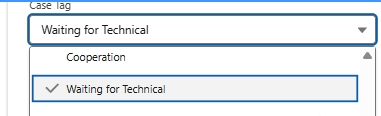
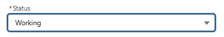

# Technical Escalation Cases — Tag, Status & Daily Follow-Up

> Source: 流程相关 · Hoi · 2026-10-30

**【技术升级处理规范 2026-10-27】** 名下有技术升级 case 的同事，请完成/检查以下操作：

1. **Case Tag** — 选中 **Waiting for Technical**
2. **Status** — 选中 **Working**

**每天查一次进度。**

——

**【Technical escalation handling standard 2026-10-27】** For every technical-escalation case you own, complete/verify the following:

1. **Case Tag** — select **Waiting for Technical**
2. **Status** — select **Working**

**Check progress once every day.**
